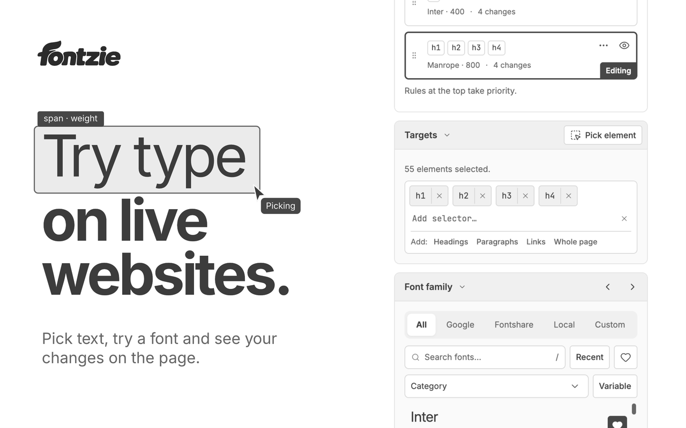

# Fontzie

Try type on. A local-first Chrome side-panel extension for experimenting with typography on live websites.

[](https://chromewebstore.google.com/detail/fontzie/okieeoellfjeaoppljeooohndgffiojd)

[Website](https://fontzie.app/) · [Report an issue](https://github.com/ale-benassi/fontzie/issues) · [Report a security issue privately](https://github.com/ale-benassi/fontzie/security/advisories/new) · Made by [Alessandro Benassi](https://alebenassi.com/).

Fontzie is open source under the [MIT License](LICENSE).

Supports Light, Dark and System themes.

## Build and install from source

Use Node 24 (see `.node-version`) and npm to build the extension.

```sh
git clone https://github.com/ale-benassi/fontzie.git
cd fontzie
npm ci
npm run build
```

1. Open `chrome://extensions` in Chrome 120 or newer.
2. Enable Developer mode and choose **Load unpacked**.
3. Select `.output/chrome-mv3` inside this project.
4. Open a regular website and click the Fontzie toolbar icon. Chrome opens the side panel and grants temporary access to that tab.
5. Pick an element or inspect a CSS selector, choose a font and adjust typography.

To restore saved edits automatically when you return, connect the website and choose **Always allow this site** in Fontzie’s **Settings**. To connect automatically on any supported website, turn on **Connect automatically on all websites** and approve Chrome’s request for access to HTTP and HTTPS websites. Use **Manage site access in Chrome** to change that permission later. Restricted Chrome pages, the Web Store and browser PDF views cannot be inspected.

```sh
npm run dev        # in-place development; see workflow below
npm run zip        # packaged extension under .output/
npx playwright install chromium
npm run lint      # Vue, TypeScript and JavaScript correctness checks
npm run lint:fix  # apply available lint fixes; review the diff
npm run verify    # formatting, lint, types, unit tests, build and browser checks
npm run test:e2e  # builds first; deterministic provider fixtures
npm run test:providers # builds first; live Google and Fontshare smoke checks
npm run catalog:update
```

`npm run format` applies the formatting checked by CI. The browser suite uses a fresh extension copy and browser profile for each test. Only those temporary copies receive deterministic font-provider responses; the shipped extension always uses the real providers. `npm run test:providers` checks live delivery separately. The playground server binds to `127.0.0.1:4318`.

GitHub Actions runs the same checks as `npm run verify` on pull requests and pushes to `main`. Three jobs share the browser suite. Each uploads a timing report, screenshots and any failure traces under `browser-results-1`, `browser-results-2` or `browser-results-3`. A manual run can also check the live font providers.

ESLint checks handwritten JavaScript, TypeScript and Vue files through `eslint.config.mjs`, including scripts and tests. It enforces correctness rules and selected checks for promise mistakes; Prettier owns formatting. See [Coding standards](docs/coding-standards.md#automatic-linting) for coverage, exceptions and rules that still require review.

## Development in your existing Chrome profile

The development server updates the unpacked extension you loaded from `.output/chrome-mv3`. Both development and production builds use this directory so Chrome keeps your saved rules, presets, custom fonts and site permissions when you switch builds.

Start the development server from the repository root.

```sh
npm run dev
```

When the build finishes, open `chrome://extensions` in the profile where you loaded the unpacked extension and click **Reload** on its Fontzie card. If you also have the store version installed, the unpacked copy shows the path to your checkout under **Details**. Open a website and click the Fontzie toolbar icon to reopen the panel. Keep the terminal running while editing.

- Vue templates and CSS update automatically in the open panel through Vite. Script changes may remount components or refresh the page, so transient UI state can reset.
- Background changes cause WXT to rebuild and reload the **whole extension**. This can close the panel. Reopen it with the toolbar icon, and refresh the website if its inspector has an old extension context.
- Manifest/configuration changes can restart the server. Reload the extension manually afterward. Toolbar icon changes also require a full extension reload: run `npm run icons:generate`, restart dev, then click **Reload**. A panel refresh alone does not update Chrome's toolbar artwork.
- After stopping/restarting the server, click **Reload** again to reconnect. During a working dev session, WXT also registers Option+R on Mac / Alt+R elsewhere; use the extensions page if that shortcut conflicts or does not work.

The server listens only on `127.0.0.1:3000` and fails if that port is occupied. Inspect the owner with `lsof -nP -iTCP:3000 -sTCP:LISTEN`; stop an old Fontzie dev terminal with Ctrl+C before starting another. The development manifest allows local scripts and HTTP/WebSocket connections on that address. WXT also adds its development `tabs` and loopback host permissions. Production builds omit those development additions.

To finish development or recover a blank panel after stopping the server:

```sh
# First press Ctrl+C in the dev terminal.
npm run build
```

Then click Fontzie's **Reload** in `chrome://extensions` and reopen the panel. Never run build/zip and dev simultaneously: they intentionally share the installed output directory. The production build works without the dev server.

Chrome can retain the development localhost site grant because Fontzie supports optional site access. If localhost was granted only for development, remove it after reloading the production build: click **service worker** on Fontzie's extension details page, select **Console**, and run:

```js
await chrome.permissions.remove({ origins: ["http://127.0.0.1/*"] });
```

Keep that grant if you already used Fontzie on local websites. The development build restores its required loopback access on the next reload; other site grants and saved data are unaffected.

To check a change, try it in the unpacked extension. Run `npm run lint`, `npm run typecheck` and `npm test` for static checks and unit tests. For the full suite, stop the dev server and run `npm run verify`. Its Playwright tests open a separate browser with temporary profiles.

## Editing

- **Floating editor:** use the header’s float icon to put the same editor over the webpage. Drag its title bar, resize from the bottom corner, minimize it or dock it back in the sidebar. Arrow keys move/resize by 10px; Shift uses 50px. Geometry stays on this device. A page reload restores an open floating editor while Chrome retains access. Closing it keeps your edits; the toolbar icon reopens the sidebar.
- **Target:** use one field for exact picks and CSS selectors. Picking appends a fixed pill with a picker icon; typing and shortcuts append editable selector pills. A rule can contain both. Hover or focus a pill to highlight its matches; hover a rule to highlight its entire target set. Enter submits a selector and Escape cancels picking. Focus a page element and press Enter while picking for keyboard selection.
- **Fonts:** search 1,984 Google families, 36 Fontshare families, system stacks, optional installed fonts and your custom families. Filter by provider/category/variable status, save favorites, or cycle families. Visible font rows load real specimens as needed; previews and repeated edits reuse loaded faces.
- **Typography:** available weights, variable axes, px/rem/em sizes, line height and spacing; advanced icon controls for style, transform, decoration, alignment, optical sizing and ligatures, plus width and OpenType tags. Icon options include tooltips, selected values and radio-group keyboard behavior. Each numeric control has a full-width slider, practical ranges for its unit and explicit minus/plus steps; typed values can exceed the slider’s common range. Reset removes an individual override. Controls begin with inspected computed values.
- **Rules:** **New** creates a blank rule and focuses the shared target field without removing existing rules. Edit, toggle, duplicate, reorder or remove independent targets. Enabled rules at the top take priority. Preview disables overrides without deleting them; Show original temporarily reveals the unedited page until Back to edited is selected. Undo/redo retain up to 80 snapshots. Edits and Preview state survive same-page tab reload, including when the panel is closed, while Chrome keeps access to the site. A different page starts its own session. Use the **Clear edits** menu for the current page or the entire site.
- **Presets:** search and choose a preset in the sticky footer to apply it immediately; Undo restores your previous rules. Save updates the selected preset with overwrite confirmation; the Presets dropdown offers Save as new at the bottom. With no selected preset, Save asks for a name. Edits keep the selected preset marked Modified. Each preset has Rename and Delete actions in the dropdown; deleting a preset keeps the current page edits. Export/import versioned JSON. Page edits, including exact picks and Preview state, save automatically on this device and recover after page reloads, tab closure and Chrome restarts. Exact picks rebind only when their selector identifies one element; missing or ambiguous targets pause. Named presets retain every rule and target; loading rebinds exact picks only when their selector uniquely identifies an element. Missing or ambiguous picks pause their rules.
- **Export** offers CSS, Tailwind v4 or a prompt for a coding assistant. CSS includes the rules and font imports. Tailwind adds theme tokens. The prompt identifies each exact pick or asks you to confirm it. Custom font exports include `@font-face` declarations and a separate download for the original files. Place those files under `./fonts/` beside the CSS and review selectors, paths and licenses before publishing.
- **Theme:** the header icon cycles Light → Dark → System, with sun, moon and monitor icons for the current mode. The tooltip names the current and next mode. Settings also offers Light, Dark or System. System follows OS changes immediately. Preference stays on this device.

Shortcuts: `/` focuses font search; ⌘/Ctrl Z undoes; ⇧⌘/Ctrl Z redoes. Shared controls support keyboard interaction. Arrow keys move through font rows.

## Shared UI controls

The panel uses source-owned [shadcn-vue](https://shadcn-vue.com/docs/introduction) components in `components/ui`, backed by Reka UI. Buttons, fields, selects, labels, sliders, switches, checkboxes, icon radio groups, tooltips and the export dialog share the same foundation. Interface controls use Lucide Vue through the app’s semantic Icon adapter or direct Lucide imports. About also uses the GitHub mark and Alessandro Benassi’s bundled website logo. Fontzie’s existing color tokens, typography and compact dimensions live in `entrypoints/sidepanel/style.css` and `components/ui/controls.css`.

`components.json` records the registry setup. The initial sources were generated with shadcn-vue CLI 2.8.2 (new-york style) and then adapted to the approved design. These files belong to the project: review registry updates as source changes and retain the token mapping and density. `ValueSlider.vue` adapts array slider values to the editor’s scalar events. Disclosures use shadcn Collapsible; section containers use shadcn Card. File pickers use the shared Input with the browser’s file chooser. Source attribution is packaged in `public/licenses/shadcn-vue.txt`.

## Font sources and privacy

Google metadata is bundled from a pinned Fontsource snapshot. Provider catalogs are packaged once as local JSON, loaded on demand, and indexed by family ID. `catalogs/provenance.json` records its source commit, date and hashes. Run `FONTSOURCE_REF=<commit> npm run catalog:update` to reuse that Google snapshot and fetch the current Fontshare catalog. Google CSS2 delivery needs no API key or account.

Fontzie offers the 36 families that Fontshare identifies as released under the SIL Open Font License. Font files load from Fontshare’s CDN when needed. If an old preset or page uses a family that is no longer available, Fontzie restores its other typography settings and shows which family needs replacing. [SIL Open Font License](https://openfontlicense.org/open-font-license-official-text/)

Custom WOFF2/WOFF/TTF/OTF files (up to 20 MB each) are parsed locally and stored in IndexedDB. Upload multiple files or drop them in Custom font files; edit family/weight/style, replace files or delete faces. Deleting a file keeps your rules and targets. Rules that lose their chosen face use the page’s font family and keep edits such as size and spacing. Files never leave your device. To use fonts already installed on your device, select a target and choose **Font family → Local → Load installed fonts**. Chrome asks for optional font access when needed.

Fontzie has no backend, account, analytics or cloud sync. Provider font downloads contact Google or Fontshare using font identifiers; they do not contain inspected page text or custom files. Preferences, automatic page drafts and reusable configurations stay in Chrome Local storage; active tab/frame ownership uses Chrome Session storage. A draft is the latest applied edit for that page URL (origin/path/query, excluding its hash). With persistent site access it restores automatically; with temporary access, click Fontzie to reconnect after restarting Chrome. Clearing local data removes stored configuration and custom files. [Privacy and performance notes](docs/privacy.md).

## Browser boundaries

Open shadow roots are supported through removable constructed stylesheets; inline important declarations inside a shadow root may outrank those sheets. Closed roots are inaccessible. Frame inspection depends on Chrome host grants. Exact picks refer to live DOM identity within the current document and do not follow framework replacement elements. On tab reload, their saved selector must resolve uniquely before Fontzie binds a fresh handle. Reusable selectors follow matching elements. Newly inserted selector matches update through CSS. Browser PDF rendering and some browser-managed documents remain restricted. Provider downloads require network access. See [privacy and browser boundaries](docs/privacy.md).

## Publishing a release

Commit the version bump to `main`, then tag that commit with the matching version and push the tag (for example, `git tag v1.0.3 <commit>` followed by `git push origin v1.0.3`). The [Verify workflow](.github/workflows/verify.yml) builds the ZIP, runs the browser tests against that build, and submits the ZIP to Google once all checks pass. Google publishes the update after approval.

To check which version is live or in review, run the [Chrome Web Store workflow](.github/workflows/store.yml) manually on `main`. GitHub authenticates using the repository variables `CWS_IDENTITY_PROVIDER` and `CWS_SERVICE_ACCOUNT` and a short-lived Google access token.

The tag run also prepares a draft GitHub Release with the exact Store ZIP, its SHA-256 checksum and the store link. Retries reuse that ZIP. The [GitHub Release workflow](.github/workflows/github-release.yml) checks Chrome’s update service twice an hour and publishes the matching draft once Chrome serves that version. Pushing the version tag is the only release action.

## Project documents

- [Coding standards](docs/coding-standards.md)
- [Product](PRODUCT.md)
- [Design](DESIGN.md)
- [Architecture](docs/architecture.md)
- [Privacy](docs/privacy.md)

UI fonts use locally bundled Fontsource Inter and JetBrains Mono, without runtime font-provider requests. Their SIL Open Font License notices are packaged in `public/licenses/THIRD-PARTY.txt`. Run `npm run fonts:generate` after updating either font package to regenerate the embedded UI font stylesheet. Other dependencies and provider font licenses apply separately. No remote executable code is loaded.

### Brand assets

The MIT License covers Fontzie’s code and documentation. Alessandro Benassi reserves the rights to the Fontzie logo, wordmark and app icons. Third-party fonts, dependencies and logos retain their respective licenses and trademark protections.

The supplied vector wordmark is shared by the sidebar and floating editor. The toolbar icon preserves the complete charcoal `fontzie-mark.svg` with a pale outline on a transparent canvas, making it readable on both light and dark toolbars. The artwork occupies 116px of a 128px canvas, with 6px padding and room for the outline. Chrome's [documented action icons](https://developer.chrome.com/docs/extensions/reference/api/action) select raster images by size; this treatment does not depend on theme detection or Firefox's `theme_icons` setting.

Source assets live in `public/branding/`; `npm run icons:generate` preserves the paths and transforms and renders 16/32/48/128px PNGs with `@resvg/resvg-js`, without launching a browser. Generated filenames include a content hash. The command also updates the SVG and panel favicon and removes superseded PNGs. Build and reload the extension to update the installed toolbar artwork. The interface uses charcoal and neutral grays, with inverted actions in dark mode, leaving the website and font specimens to supply color.
